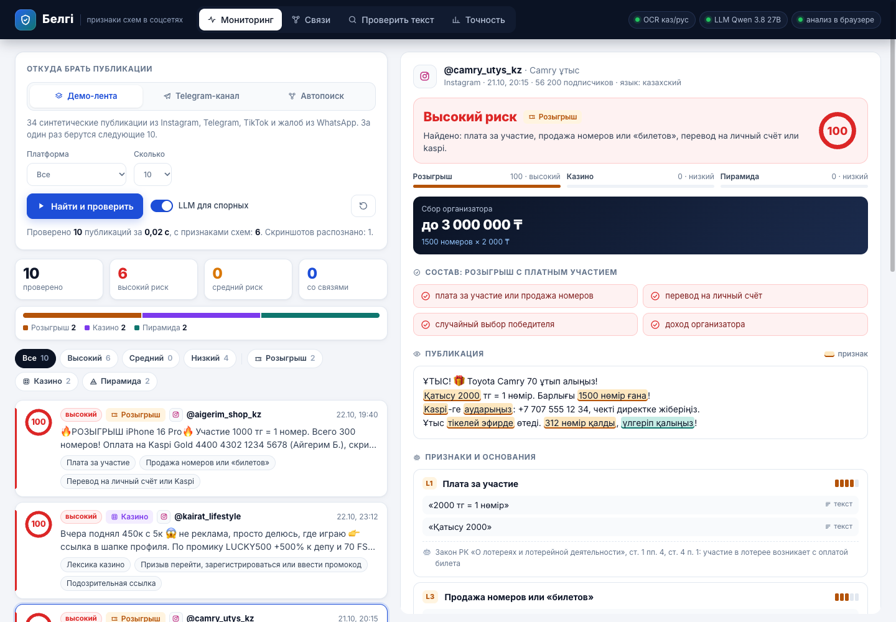

# Белгі

**Открыть:** https://belgi-kz.pages.dev



Демо панели аналитика для хакатона SafeNet KZ, пилот для Шымкента. Система сама собирает публикации, находит в них признаки платных розыгрышей, скрытой рекламы казино и финансовых пирамид, ставит уровень риска и объясняет его цитатами и нормами закона. Решение о законности принимает человек.

## Запуск

```
./run.sh
```
Откроется на http://127.0.0.1:8090. Скрипт сам поднимает локальную LLM (llama-server на :8081), если в `models/` лежит `Qwen3.5-9B-Kazakh.Q4_K_M.gguf`. Без модели всё работает на правилах, LLM просто выключена.

Нужно: Python-окружение `.venv` (fastapi, uvicorn, httpx, pillow, python-multipart), `brew install tesseract llama.cpp` и языки `kaz`, `rus` в tessdata.

## Публичная версия

- https://belgi-kz.pages.dev (Cloudflare Pages)
- https://belgi.gasguard.workers.dev (тот же сайт как Cloudflare Worker)

Бесплатно, без «засыпания», открывается с телефона и ноутбука. Анализ идёт прямо в браузере посетителя: тот же Python-движок запускается через Pyodide, скриншоты распознаёт tesseract.js (казахский, русский, английский). Cloudflare только раздаёт сайт и обслуживает три маршрута: чтение публичных Telegram-каналов (`/api/tg/<канал>`), картинки из постов (`/api/tgimg`) и LLM для спорных случаев (`/api/llm`, Workers AI, Qwen 3.8 27B с выключенными рассуждениями). У каждого посетителя своя очередь, потому что всё хранится в его браузере.

Обновить:
```
.venv/bin/python scripts/build_web.py                    # сборка: интерфейс + движок + демо-данные
cd deploy/cloudflare && wrangler deploy                  # Worker
cd deploy/pages && wrangler pages deploy --branch main   # Pages
.venv/bin/python scripts/check_browser.py https://belgi-kz.pages.dev/ /tmp   # проверка в настоящем Chrome
```

## Режим «Шымкент»

По умолчанию панель показывает только схемы, нацеленные на жителей Шымкента, и собирает их сама.

- **Привязка к городу** (`belgi/geo.py`): название города во всех формах (Шымкенте, Шымкентте, Shymkent, Чимкент), районы (Абайский, Әл-Фараби, Еңбекші, Қаратау, Туран), микрорайоны и места (Нурсат, Кайтпас, Тассай, Тауке хана), городской телефон 8 7252, городской аккаунт или канал. Если у аккаунта города нет, но у него та же карта, телефон или промокод, что у шымкентской схемы, он тоже попадает в режим «Шымкент». Публикации про другие города и без города скрыты, чип «Только Шымкент» в строке фильтров показывает всё. На балл риска привязка не влияет.
- **Сборщик в облаке** (`deploy/cloudflare/src/shym.js`): Cloudflare cron каждые 10 минут читает открытые каналы города (Shymkent Online, OTYRAR, акимат, «Работа Шымкент», «Шымкент сейчас») и каналы, на которые они ссылаются, и складывает посты в KV. Работает, даже когда панель никто не открыл. Открытая панель забирает собранное, разбирает его в браузере и сама проверяет новое каждые 5 минут.
- **Свой сервер** без облака:
  ```
  .venv/bin/python -m belgi.monitor              # обход каждые 15 минут
  .venv/bin/python -m belgi.monitor --once       # один обход
  ```
  Результат в `data/shymkent/`: `cases.json` (шымкентские публикации с уровнем риска), `channels.json`, `reports/<кейс>.html` (справка на каждую схему).

## Запуск на любом компьютере (Docker)

```
docker compose up --build
```
Панель на http://localhost:8090. Работают правила и распознавание скриншотов. Локальная LLM подключается так: `docker compose --profile llm up --build`, модель кладётся в `./models`. Внутри Docker на Mac LLM идёт без видеокарты и думает медленно.

Облачная LLM вместо локальной задаётся переменными `BELGI_LLM_URL` (OpenAI-совместимый адрес), `BELGI_LLM_KEY`, `BELGI_LLM_MODEL`. `BELGI_LLM=off` выключает LLM.

## Что умеет демо

- **Одна кнопка «Проверить всё».** Разбирает демо-ленту целиком (34 синтетические публикации: Instagram, Telegram, TikTok-эфиры, жалобы со скриншотами из WhatsApp), забирает то, что сборщик собрал в открытых каналах Шымкента, строит связи и сверяется с разметкой. Строки хода сами становятся итогом, синтетика и настоящие каналы показаны раздельно и никогда не складываются. Ссылка `https://belgi-kz.pages.dev/#all` запускает проверку без нажатий. Другие источники (любой публичный Telegram-канал через t.me/s/, автопоиск) и настройки в свёрнутом блоке.
- **Автопоиск по цепочке.** Из стартовых каналов система берёт ссылки и упоминания других каналов и проверяет их; каналы, на которые ссылаются подозрительные посты, идут первыми.
- **Своя очередь у каждого посетителя** (cookie), ограничения на размер файлов и частоту запросов.
- **Карточка кейса.** Признаки с цитатами, источник (текст, скриншот, минута эфира, профиль), норма закона или пункт методики АФМ, «не найдено», контрпризнаки, вычисления (доходность против вкладов, сбор организатора), связи.
- **Связи.** Граф аккаунтов через общие карты, телефоны, промокоды, ссылки и контакты «кураторов». Номера хранятся только хешем.
- **Проверить пример.** Свой текст или скриншот.
- **Справка для ведомства.** Страница для печати в PDF.
- **Метрики** на размеченной демо-ленте.

## Устройство

| Файл | Что делает |
|---|---|
| `belgi/normalize.py` | снимает маскировку (к@зино, 1w1n, «к а з и н о», латиница в кириллице), сводит казахские буквы, хранит карту позиций для цитат |
| `belgi/lexicon.py` | словарь признаков ru/kk/транслит с весами и нормами, контрпризнаки, белые списки |
| `belgi/entities.py` | суммы, обещанная доходность, карты, телефоны, IBAN, ссылки (сокращатели, партнёрские метки, зеркала), промокоды |
| `belgi/engine.py` | баллы по трекам, «составы», уровни, связи между аккаунтами |
| `belgi/llm.py` | LLM только для спорных случаев; цитаты сверяются с текстом, уровень меняется максимум на ступень |
| `belgi/ocr.py` | Tesseract eng+rus+kaz |
| `belgi/sources.py` | демо-лента и публичные Telegram-каналы |
| `belgi/crawl.py` | автопоиск по цепочке каналов |
| `belgi/geo.py` | привязка публикации к городу, стартовые каналы Шымкента |
| `belgi/monitor.py` | автономный обход каналов Шымкента по расписанию |
| `belgi/server.py` | API и справка |
| `belgi/core.py` | общая логика сессии для сервера и браузера |
| `belgi/webapi.py` | API для браузера (Pyodide) |
| `web/` | интерфейс без сборки; `static.js` включает режим «анализ в браузере» |
| `deploy/cloudflare`, `deploy/pages` | Worker и Pages: маршруты Telegram и LLM, сборщик Шымкента по cron |
| `data/feed.json` | демо-лента с разметкой |
| `scripts/make_images.py` | синтетические скриншоты |

Проверка на ленте: `.venv/bin/python -m belgi.evaluate`.

## Ограничения

- Метрики на демо-ленте 100%, но лента и словари написаны вместе, поэтому это проверка работоспособности, а не точности. Для честной оценки нужен отдельный тест от других людей, особенно на казахском.
- Эфиры в демо даны готовой транскрипцией; распознавание звука (whisper) ещё не подключено.
- Ссылки не открываются, разбирается только их вид. Разворот редиректов нужно делать через изолированный сервис.
- Instagram, TikTok и WhatsApp автоматически не читаются: у них нет открытого доступа, а правила хакатона требуют соблюдать правила платформ. Оттуда материалы попадают ссылкой, скриншотом или жалобой.
- Поиск Telegram-каналов по ключевым словам требует аккаунта Telegram (API); сейчас поиск идёт по цепочке от стартовых каналов.
- В открытых каналах Шымкента сейчас в основном новости и вакансии, схем там пока нет; публичных каналов с открытой лентой у города мало, закрытые группы и чаты сборщик не читает.
